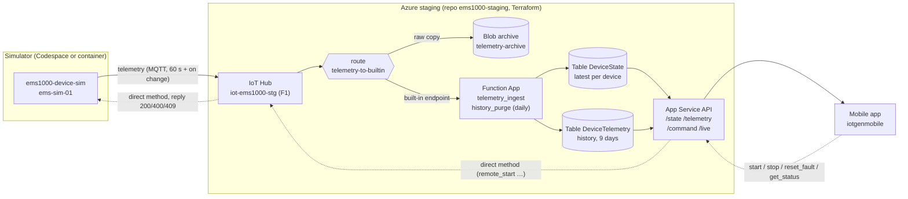

# ems1000-device-sim

A Python virtual **EMS-1000** generator controller that replaces the Wokwi ESP32 simulation (`wokwi-proj-09`).
It connects to Azure IoT Hub over MQTT (TLS, port 8883) and sends the same telemetry the firmware sends.

**Status: M5.** Heartbeat telemetry (M1), state machine + direct-method commands (M2), a physics-lite model of the **Sumec Firman ECO4990ES** with automatic faults, keyboard shortcuts, YAML scenarios and `--speed` (M3), CI, a Docker image and test/troubleshooting guides (M4), device twin with remote settings (M5), local web control panel (M6).

[](https://github.com/okeyf16/ems1000-device-sim/actions/workflows/ci.yml)

Guides: [live tests](docs/TESTING.md) · [troubleshooting](docs/TROUBLESHOOTING.md) · [firmware build reference](docs/BUILD_REFERENCE.md)

## How it fits together



Solid arrows: telemetry going up. Dotted arrows: commands coming back down. A command's reply comes
straight back along the same path (the API mirrors the device's status code), while the resulting
state change arrives a moment later as a normal telemetry message.

## Quick start in GitHub Codespaces

1. Repo → **Code → Codespaces → Create codespace on main**. Python 3.11, the Azure CLI and the dependencies install automatically.
2. Add the secret `IOTHUB_DEVICE_CONNECTION_STRING` under GitHub **Settings → Codespaces → Secrets** (give it access to this repo), then rebuild or reopen the codespace. You can use a local `.env` instead.
3. `python cli.py run`

Codespaces stop after the idle timeout (30 min by default). A running script doesn't count as activity, so for long unattended runs see M4 (Container Apps).

## Quick start (local)

```bash
python3.11 -m venv .venv && source .venv/bin/activate
pip install -r requirements-dev.txt

# 1. Offline check: prints 3 payloads, no Azure needed
python cli.py run --dry-run --interval 2 --count 3

# 2. Register the device (needs `az login`; writes .env)
bash scripts/register_device.sh <your-iot-hub-name> ems-sim-01 <resource-group>

# 3. Go live
python cli.py run                 # 60 s heartbeat, Ctrl+C to stop
python cli.py run --interval 10   # demo mode (uses ~8,640 msgs/day: the guard will stop it at 7,500)
python cli.py budget              # messages used today (UTC)
```

## Checking that it works (M1 acceptance)

1. **Messages arrive at the hub:**
   `az iot hub monitor-events --hub-name <hub> --device-id ems-sim-01 --properties all`
   You should see the JSON body, `content-type: application/json` and a `traceparent` property.
2. **The pipeline stores them:** the ingest Function upserts the `DeviceState` table row
   `PartitionKey=ems-sim-01, RowKey=latest`. Check it in the portal's Storage browser, or with
   `GET /api/devices/ems-sim-01/state` on the staging API.
3. **Unit tests:** `pytest -q`

## Telemetry (schema v1, < 512 bytes; same fields and order as the firmware)

`sv, id, ts, boot, seq, v, i, f, fuel, oil, t, vb, flt, rssi, run`

- `boot` is kept in `.state/<device>.json` and goes up on every restart, like the firmware's `bootCount`.
- `seq` starts again at 1 after each boot.
- Every payload is checked against the schema (fields, types, ranges, size) before sending. A payload that fails is logged and **not** sent.

In M1 the generator is always **OFF** (`run=0`, v/i/f = 0, battery resting, engine at ambient temperature).

## Commands (M2)

The sim listens for IoT Hub direct methods while `python cli.py run` is running:

| Method (alias) | Effect | Replies |
|---|---|---|
| `remote_start` (`start`) | Off -> Crank (2.5 s) -> Run | 200 accepted · 400 already running/stopping · 409 safety check failed or fault lockout |
| `remote_stop` (`stop`) | Crank/Run -> Stop (3 s) -> Off | 200 accepted (also when already off: `note: already off`) |
| `reset_fault` | Fault -> Off if the condition has cleared | 200 cleared · 409 condition still present · 200 `no_fault` |
| `get_status` | Current state + readings, no telemetry message used | 200 |
| anything else | | 404 `unknown_method` |

Replies go back immediately; crank and stop finish in the background. Every state change
sends one extra telemetry message (`run`: 0 Off, 1 Crank, 2 Run, 3 Stop, 4 Fault).
Each reply echoes `cmd_id` (the API's `command_id`, or IoT Hub's request id).

Readings come from the generator model below.

Try it (sim running in one terminal):
```bash
# through the staging API (app path)
curl -s -X POST https://app-ems1000-stg-4s1y.azurewebsites.net/api/devices/ems-sim-01/command \
  -H 'Content-Type: application/json' -d '{"command":"start"}'
# or straight at IoT Hub
az iot hub invoke-device-method --hub-name iot-ems1000-stg --device-id ems-sim-01 \
  --method-name remote_start --method-payload '{}'
```

## Generator model (M3): Sumec Firman ECO4990ES

3.0 kVA rated / 3.2 kVA max, 220 V / 50 Hz, conventional alternator with AVR, SPE200E engine,
15 L tank (~12 h at 50 % load), overload and low-oil protection, electric start.
The model steps once per second (`simulation.tick_seconds`); parameters live under `sensors:` in
`config/default.yaml`.

| Reading | Model |
|---|---|
| Load `i` | default 25 % of rated (13.6 A) ≈ 3.4 A |
| Fuel | 0.55 + 1.40 × load (L/h): 12 h at 50 %, 16.7 h at 25 %, 7.7 h at full load (estimate fitted to the spec) |
| Temperature `t` | warms towards ambient + 35 + 25 × load (≈ 69 °C at 25 %) with an 8 min time constant; cools when off |
| Voltage `v` | 220 V, AVR sag to ≈ 214 V at rated; sharp sag in overload |
| Frequency `f` | governor droop ≈ 51.5 Hz no load → 50 Hz rated; dips in overload |
| Battery `vb` | 10.6 V while cranking, charges towards 13.8 V running, rests at 12.6 V |

**Automatic faults and alerts** (`flt` bits):

| Condition | Effect |
|---|---|
| Fuel reaches 0 % | stall → Fault, bit 1 |
| Oil critical (2) while running | low-oil protection → Fault, bit 0 |
| Temperature > 95 °C | Fault, bit 2 |
| Start with battery < 11 V | refused 409, Fault, bit 3 |
| Load > rated | voltage/frequency out of range → alert bits 4/5 (engine keeps running) |
| Load > 3.2 kVA for 5 s | output breaker trips: `v`, `i` = 0, bits 4/5 set until load is reduced and the breaker reset |
| Fuel < 10 %, oil low (1) | warning: one extra telemetry message, no fault |

Start interlock (start and `reset_fault`): refuses on oil critical, fuel < 5 %, engine > 80 °C,
or battery < 11 V. Oil low (1) only warns. `reset_fault` succeeds once the condition has gone.

## Keyboard shortcuts (M3)

While `python cli.py run` is running in a terminal, single keys (no Enter) act on the
generator directly, like someone standing at it. They use no IoT Hub messages.

| Key | Action | Key | Action |
|---|---|---|---|
| `s` | start | `h` | overheat on/off (cooling failure) |
| `x` | stop | `b` | weak battery on/off |
| `r` | reset fault | `p` | reset breaker (refused while overloaded) |
| `+` / `-` | load ±10 % | `t` | send telemetry now |
| `o` | oil OK → low → critical | `i` | show status |
| `f` | fuel 9 % (warning) | `?` | list the keys |
| `e` | fuel empty | Ctrl+C | quit |
| `F` | refuel to 100 % | | |

With several devices configured, the keys (and scenarios) drive the first one.

## Speed and scenarios (M3)

`--speed N` runs the generator model N times faster: `--speed 60` makes 1 real minute one
engine hour, so a full tank at 50 % load empties in 12 minutes instead of 12 hours. Only the
physics speeds up (fuel, temperature, battery). The heartbeat (`--interval`), commands and
the 2.5 s crank / 3 s stop stay in real time, so the message budget is unaffected. Maximum 3600.

A scenario plays a scripted fault timeline (see `config/scenarios/`):

```bash
python cli.py scenarios                                   # list them
python cli.py run --interval 10 --scenario overload       # breaker trip, ~1.5 min
python cli.py run --interval 10 --scenario out-of-fuel    # stall + refuel, ~3 min (speed 60)
python cli.py run --interval 10 --scenario overheat       # trip + cool-down, ~1 min
python cli.py run --interval 10 --scenario normal-day     # load profile, ~2.5 min
```

Each scenario sets its own speed; `--speed` overrides it. Keys still work during a scenario.
When it finishes the sim keeps running until Ctrl+C.

`--headless` turns the keyboard off, for runs with no terminal (a container or CI job, M4):
`python cli.py run --headless --scenario out-of-fuel`.

## Device twin (M5)

The sim keeps its IoT Hub **device twin** up to date and accepts settings through it.

**Reported** (at start-up, on every state or fault change, and when settings are applied; never periodically):

| Property | Example |
|---|---|
| `device` | `{"model": "Sumec Firman ECO4990ES", "sim_version": "0.5.0", "boot": 12, "started_at": "…Z"}` |
| `state`, `run`, `flt` | `"RUNNING"`, `2`, `0` |
| `last_fault` | `{"bits": 2, "reason": "Out of fuel: engine stalled", "at": "…Z"}`, kept after the reset |
| `settings` | the values in use |
| `settings_status` | per desired setting: `{"status": "applied" \| "rejected", "reason": …, "desired_version": n}` |

**Desired settings** (portal: IoT Hub → Devices → `ems-sim-01` → **Device twin**; or the staging API `PATCH /api/devices/{id}/twin`, and `DELETE /api/devices/{id}/twin/settings` to clear):

| Setting | Range | Effect |
|---|---|---|
| `telemetry_interval_s` | 10–3600 (whole) | heartbeat interval, applied straight away |
| `load_pct` | 0–150 | generator load (like `+`/`-`) |
| `low_fuel_warn_pct` | 1–50 | low-fuel warning threshold (default 10) |
| `overtemp_c` | 85–120 | over-temperature trip (default 95) |
| `min_start_battery_v` | 10.0–12.5 | start interlock (default 11.0) |
| `speed` | 1–3600 | model speed (like `--speed`) |

- A bad value is rejected with a reason in `settings_status`; the rest of the same change still applies.
- `null` clears a setting: the sim goes back to its config value. Through the API: `DELETE /api/devices/{id}/twin/settings` clears all six (or `?name=load_pct` for one).
- **Desired settings persist in IoT Hub and override `config/default.yaml` at start-up** (logged as
  "overrides config"). Changes made while the sim is offline apply when it connects.
- Keys and the twin can both change load and speed: the last change wins, and `settings` shows what's in use.
- Each twin update counts as one message in the daily budget (a few dozen a day).

## Web control panel (M6)

```bash
python cli.py run --interval 10 --panel
```

In a Codespace, a notification offers **Open in Browser** for port 8080 (or use the **Ports** tab →
*EMS panel* → globe icon). Locally, open http://localhost:8080.

| Area | What it does |
|---|---|
| Lamps | Off / Cranking / Running / Stopping / Fault, like the generator controller's annunciator |
| Dials | Voltage, current, frequency, fuel, temperature, battery, with green/amber/red bands at the sim's own limits; faults, alerts and warnings in plain words |
| Controls | Start, stop, reset fault; load slider; fault injection (oil, fuel 9 % / empty / refuel, overheat, weak battery, breaker reset); speed |
| Scenario | Play or stop any scenario, with step-by-step progress |
| History | The last 30 minutes as charts (kept in the sim's memory; running periods shaded, faults marked) |
| What Azure holds | The staging API's `/state` and `/twin` every 10 s while the page is visible, with plain-words checks when the cloud is behind or differs |

- The panel itself uses no IoT Hub messages; its buttons do what the keys do (and the keys still work).
- **Access (solo):** the panel listens on 127.0.0.1 and the Codespace port is **Private** by default, so only you
  (signed in to GitHub) can open it. Keep it private: there's no PIN yet (planned add-on for shareable links).
  Actions need the panel's own header and JSON body, so other websites can't trigger them.
- Cloud view: `panel.api_url` in `config/default.yaml` (or `EMS_API_URL`); empty turns it off.
- API key for the cloud view: the Codespace secret (or `.env` entry) `EMS_API_KEY`, one of the staging API's keys. Never put it in the YAML.
- Gauges: voltage, load %, fuel, engine temperature and battery charge (estimated from voltage; held at the last engine-off value while running) as dials; frequency and load current as vertical strips; oil as a lamp (the sensor is a float switch). Times are West Africa Time.
- Theme: **Dark theme / Light theme** button in the header. Remembered in your browser; the first visit follows your system setting.
- The cloud view reads the stored state every 10 s and alerts every 30 s (free table reads), and the device twin every 2 minutes, because twin reads count against IoT Hub's 8,000 daily messages.
- Options: `--panel-port 8081`; `--panel-host 0.0.0.0` only inside a container (`docker run -p 8080:8080 …`).

## Docker

The image runs the simulator headless (no keyboard). Secrets are passed in at run time, never
built into the image. CI builds the image and runs a dry-run smoke test on every PR.

```bash
docker build -t ems1000-device-sim .
docker run --rm ems1000-device-sim --dry-run --interval 2 --count 3          # offline check
docker run --rm -e IOTHUB_DEVICE_CONNECTION_STRING ems1000-device-sim       # live, 60 s heartbeat
docker run --rm -e IOTHUB_DEVICE_CONNECTION_STRING ems1000-device-sim \
    --interval 10 --scenario out-of-fuel                                      # live scenario
```

Anything after the image name is added to `python cli.py run --headless`. To keep the boot
counter and daily message count across container restarts, mount a volume:
`-v ems-sim-state:/app/.state`. The Codespace includes Docker (after a rebuild of the codespace; see docs/TROUBLESHOOTING.md if the rebuild fails).
Not deployed anywhere yet; Azure Container Apps is the planned home for 24/7 runs.

## Development checks

```bash
pip install -r requirements-dev.txt
ruff check .        # lint (config in pyproject.toml)
pytest -q           # 140 tests, ~20 s
```

The same checks run in GitHub Actions on every pull request and push to `main` (`.github/workflows/ci.yml`).

## Free-tier budget

IoT Hub F1 allows **8,000 messages per UTC day for the whole hub**, and direct-method calls count too.
Direct-method calls count too. The simulator counts its own telemetry and every command it receives in `.state/budget.json` (the count survives restarts and resets at 00:00 UTC) and stops sending at `budget.stop_at` (7,500 by default).
One device at 60 s uses 1,440 messages a day.

## Several devices

Add ids under `devices:` in `config/default.yaml`, then register each one with the script.
Each device gets its own variable `IOTHUB_CONN_<ID>` in `.env`, and each runs in its own thread.

## Layout

```
config/default.yaml   device ids, cadence, budget, sensor baseline
sim/config.py         YAML + .env loading
sim/transport.py      IoT Hub connection (azure-iot-device), behind an interface so paho-mqtt can replace it later
sim/telemetry.py      payload builder + contract validation + traceparent
sim/physics.py        ECO4990ES physics-lite model, automatic faults, interlock (M3)
sim/sensors.py        one set of readings (telemetry units)
sim/controls.py       local actions + keyboard shortcut map (M3)
sim/keyboard.py       single-key input in the terminal (M3)
sim/scenario.py       YAML scenario loader and player (M3)
sim/twin.py           device twin: reported properties, desired settings (M5)
sim/panel/            web control panel: server.py + static page (M6)
config/scenarios/     scenario files (M3)
docs/                 live test guide, troubleshooting (M4)
Dockerfile            headless container image (M4)
.github/workflows/    CI: ruff, pytest, Docker build + smoke test (M4)
sim/state_machine.py  Off/Crank/Run/Stop/Fault with background timers
sim/commands.py       direct-method names, aliases and replies
sim/budget.py         daily message guard
sim/persist.py        boot counter / state files
sim/device.py         heartbeat loop
cli.py                command line
scripts/register_device.sh
```
