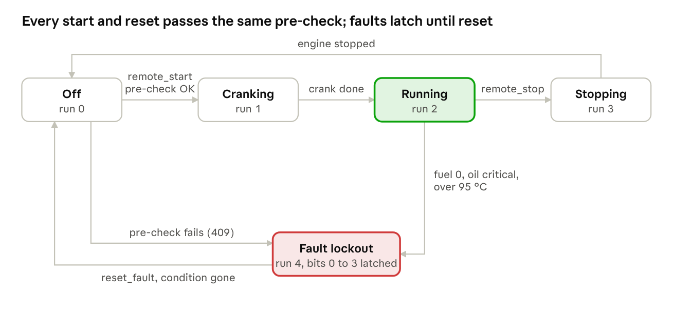

# EMS-1000 build reference

Exact strings, examples and commands behind the *EMS-1000 Device–Cloud Interface Spec* (the
pre-read). Section numbers match the spec: A1 goes with section 1, A2 with section 2, and so on.



## A1. Connection details

| Setting | Value |
|---|---|
| Host | `iot-ems1000-stg.azure-devices.net`, port 8883 |
| Client ID | the device ID |
| Username | `iot-ems1000-stg.azure-devices.net/<device id>/?api-version=2021-04-12` |
| Password | `SharedAccessSignature sr=iot-ems1000-stg.azure-devices.net%2Fdevices%2F<device id>&sig=<signature>&se=<expiry epoch s>` |
| TLS | 1.2 minimum; validate against DigiCert Global Root G2 |
| Keep-alive | 60–120 s. IoT Hub notices an unclean drop (power cut) only after about 1.5 × the keep-alive; staging then raises **Device offline** after a further 2 minutes. Longer keep-alives delay that alert |
| After every connect | re-subscribe to the method and twin topics |

## A2. Telemetry

**Topic:** `devices/<device id>/messages/events/$.ct=application%2Fjson&$.ce=utf-8&traceparent=<value>`, QoS 1.

`traceparent` = `00-<32 hex trace id>-<16 hex parent id>-01`.

```json
{"sv":1,"id":"ems-sim-01","ts":1794666969792,"boot":12,"seq":348,"v":218.5,"i":3.41,"f":51.12,"fuel":84.9,"oil":0,"t":68.7,"vb":13.8,"flt":0,"run":2,"rssi":-68}
```

### The four non-reading fields

Four fields aren't gauge readings, but the cloud depends on them:

| Field | What it is | Values | Why it's needed |
|---|---|---|---|
| `sv` | Schema version of the message | `1` today | Lets the cloud read old and new firmware side by side when telemetry v2 arrives (predictive-maintenance summaries). Without it, a format change breaks every deployed unit |
| `flt` | Fault and warning bitmask | Bits 0–3 latched faults: 0 low oil, 1 low fuel, 2 over-temperature, 3 low starter battery. Bits 4–5 warnings: 4 voltage, 5 frequency out of range. `0` = all clear; e.g. `48` = voltage + frequency warnings | Drives the start pre-check, the fault lockout, alerts, the app's "why won't it start?" card and the panel lamps. The API decodes it into `faults` and `warnings` |
| `boot` | Restart counter: +1 at every power-up, kept in flash (NVS) | 1, 2, 3, … | With `seq` it makes each message unique, which is how the cloud drops duplicates; a `seq` gap within one boot means lost messages; frequent boots point to power or brown-out problems |
| `rssi` | Mobile signal strength in dBm | About −50 (excellent) to −110 (unusable); below about −100 expect drop-outs | Explains why a unit goes offline, warns before it goes silent, and helps choose where to mount it |

`seq` (message counter, back to 1 at each boot) and `ts` (device clock, Unix epoch in
milliseconds, UTC, after SNTP sync) complete the set. The device always sends UTC; the API,
panel and app show West Africa Time (UTC+1).

## A4. Direct methods

| Purpose | Topic |
|---|---|
| Subscribe | `$iothub/methods/POST/#` |
| Request arrives | `$iothub/methods/POST/<method name>/?$rid=<request id>` |
| Reply | `$iothub/methods/res/<status>/?$rid=<request id>` |

Request body from the API: `{"command_id":"<8 hex>"}`. Reply example:

```json
{"result":"accepted","state":"CRANKING","cmd_id":"9f3a01c2"}
```

The `get_status` reply adds `state`, `run`, `flt` and `readings` (the telemetry readings).

## A5. Device twin

| Purpose | Topic |
|---|---|
| Subscribe: twin replies | `$iothub/twin/res/#` |
| Subscribe: desired changes | `$iothub/twin/PATCH/properties/desired/#` |
| Read the whole twin | publish an empty body to `$iothub/twin/GET/?$rid=<n>` |
| Update reported | publish JSON to `$iothub/twin/PATCH/properties/reported/?$rid=<n>` |

Reported example:

```json
{"device":{"model":"Sumec Firman ECO4990ES","fw_version":"1.0.0","boot":12,"started_at":"2026-11-15T09:12:03Z"},
 "state":"RUNNING","run":2,"flt":0,
 "last_fault":{"bits":2,"reason":"Out of fuel: engine stalled","at":"2026-11-15T10:01:44Z"},
 "settings_status":{"load_pct":{"status":"rejected","reason":"not supported on hardware","desired_version":7}}}
```

## A7. Message budget detail

The free tier meters every operation in 0.5 KB blocks ([IoT Hub billing](https://learn.microsoft.com/azure/iot-hub/iot-hub-devguide-pricing)).

| Traffic | Messages | Per day, one device |
|---|---|---|
| Heartbeat every 60 s (~155 bytes) | 1 each | 1,440 |
| On-change telemetry | 1 each | depends on events |
| Each command | 1 request + 1 reply | small |
| Twin read and reported updates | 1 per 0.5 KB | small if patches stay short |

Cloud processing: the route `telemetry-to-builtin` feeds the Function `telemetry_ingest`, which
writes `DeviceState` (latest row per device) and `DeviceTelemetry` (history, 9 days). The route
`telemetry-to-archive` copies raw messages to blob storage; malformed JSON goes to a dead-letter blob.

## A9. Testing against staging

1. Register the unit (cloud owner), then share its connection string securely:
   ```bash
   az iot hub device-identity create --hub-name iot-ems1000-stg --device-id <device id>
   az iot hub device-identity connection-string show --hub-name iot-ems1000-stg --device-id <device id>
   ```
2. Watch messages arrive:
   ```bash
   az iot hub monitor-events --hub-name iot-ems1000-stg --device-id <device id> --properties all
   ```
3. Send a command the way the API does:
   ```bash
   az iot hub invoke-device-method --hub-name iot-ems1000-stg --device-id <device id> --method-name remote_start --method-payload '{"command_id":"test0001"}'
   ```
4. Check the cloud's view at https://app-ems1000-stg-4s1y.azurewebsites.net/docs (`/state`, `/twin`).
5. Compare with the simulator: [TESTING.md](TESTING.md) (tests M1-01 to M6-07); `python cli.py run --dry-run` prints the exact messages.

## Sources

- Firmware spec: EMS-1000 Wokwi ESP32 firmware and simulation spec (wokwi-proj-09)
- Reference device: this repository
- [IoT Hub billing and metering](https://learn.microsoft.com/azure/iot-hub/iot-hub-devguide-pricing) · [IoT Hub quotas and throttling](https://learn.microsoft.com/azure/iot-hub/iot-hub-devguide-quotas-throttling)
