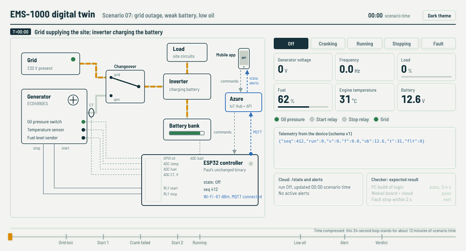
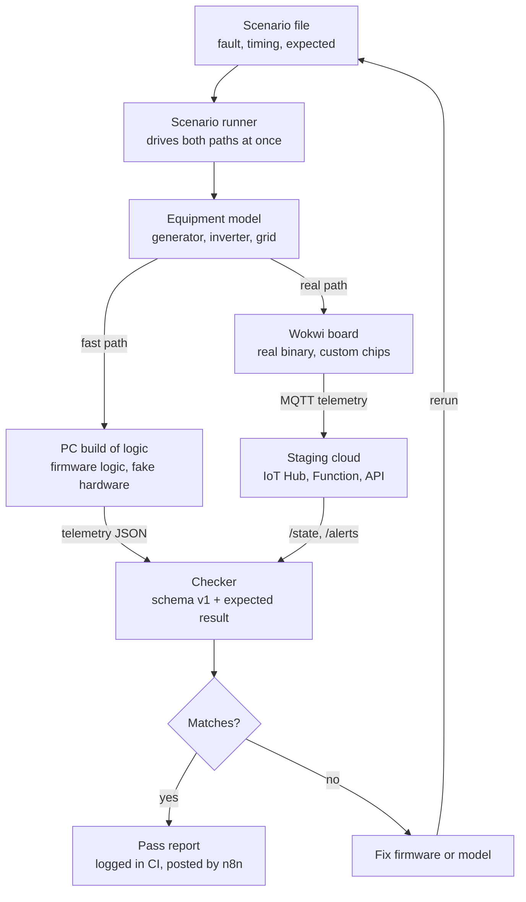
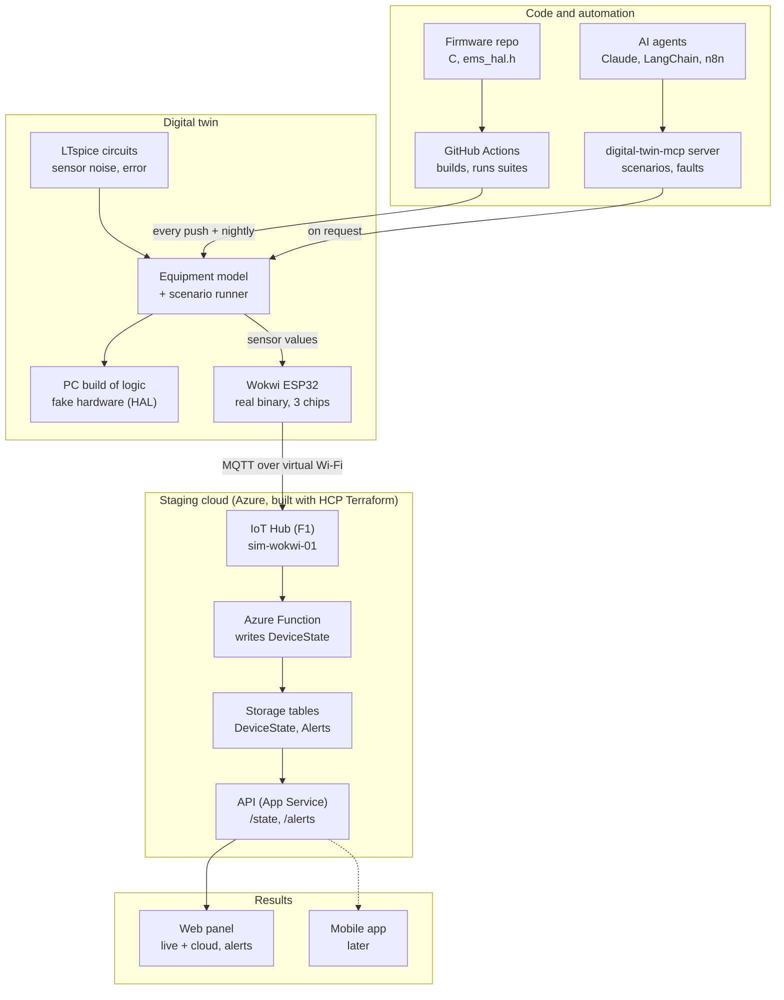

# Digital twin simulator plan (prototype)

As of 2026-11-21. Status: **plan agreed, not started**. The next step is the stage 0 coupling trial.

The digital twin is a fully virtual EMS-1000. Its job is to test the firmware, and find deployment risks, before hardware reaches a site. The recommended 80/20 plan takes about 140 hours in total over 4–5 weeks.

> "Digital twin" here means the whole simulated system, and its files use the `digital-twin` name. "Twin" on its own in this repo (`sim/twin.py`) means the IoT Hub **device twin**: the device's settings and reported properties in the cloud.



*Mock-up of the finished product running scenario 07 (grid outage, weak battery, low oil). For full size with a dark/light theme switch, download [`snapshot.html`](snapshot.html) and open it in a browser. Readings are illustrative, and time is compressed: the 24-second loop stands for about 12 minutes.*

## Contents

- [Purpose and scope](#purpose-and-scope)
- [Options considered](#options-considered)
- [Recommended 80/20 plan](#recommended-8020-plan)
- [Process and logic flow](#process-and-logic-flow)
- [Integration](#integration)
- [Automation and CI](#automation-and-ci)
- [Follow-up plan for deferred items](#follow-up-plan-for-deferred-items)
- [Not covered and assumptions](#not-covered-and-assumptions)
- [Decisions and next steps](#decisions-and-next-steps)

## Purpose and scope

- **What it mimics:**
  - the ESP32 and its wiring to sensors and relays
  - the Sumec Firman ECO4990ES generator
  - the inverter/battery and the grid changeover
  - the link to the staging cloud
- **Lead outcomes (first wave):**
  - testing the firmware
  - deployment planning (wiring, sensing and site problems)
- **Later outcomes:**
  - demos and installer training
  - synthetic failure data for predictive maintenance
- **Constraint:** fully virtual first. No hardware-in-the-loop until a board exists.
- **Builds on:**
  - this simulator
  - the staging cloud
  - telemetry schema v1 (see [BUILD_REFERENCE.md](../BUILD_REFERENCE.md))

## Options considered

Option B (Wokwi-centred) scored 139/190 and option A (free/open source) scored 127. The plan uses B for realism and borrows A's PC build for speed and coverage. Option C is shelved for now.

| Option | What it is | Score /190 | Full-build effort | Running cost |
|---|---|---|---|---|
| **A. Free / open source** | The firmware's control logic built for a PC with fake hardware calls, plus Espressif QEMU for the real binary; Python equipment model; LTspice/ngspice | 127 | ~330 h | €0 |
| **B. Wokwi-centred** | The unchanged firmware binary on Wokwi's emulated ESP32, custom chips for the sensors, virtual Wi-Fi/MQTT to staging; same shared layers | 139 | ~250 h | Wokwi Pro €20/seat/month |
| **C. Engineering suites** | MATLAB/Simulink with Simscape Electrical, PLECS or Proteus | Not scored | Not estimated | Licences |

**Why A scores higher on CI, apart from Wokwi's CI-minutes cap:**
- the PC build supports code coverage and memory/undefined-behaviour checkers
- it runs faster than real time, and in parallel
- it needs no outside service or token
- failed runs are easier to debug

B's CI strength is that it tests the real binary against real peripherals.

**What shelving C gives up:**
- electrical transient detail (surges, inrush, harmonics, AVR/governor dynamics)
- validated microgrid models
- automatic code generation
- real-time hardware-in-the-loop rigs
- standards and power-quality checks
- credibility with utilities and technical investors

To keep the door open, the equipment models are built so they can be exported in FMI format, and the LTspice work is kept. C is revisited when a trigger in the [follow-up plan](#follow-up-plan-for-deferred-items) fires.

## Recommended 80/20 plan

Six stages take about 45% of the full combined effort and deliver most of the firmware-testing and deployment value. Stage 0 is a go/no-go gate, and stage 6 is deferred.

| Stage | How A and B combine | Outcome | Steps | Firmware asks (Paul) | Total h |
|---|---|---|---|---|---|
| **0. Coupling trial** | B only: one Wokwi custom chip (voltage sensor) reads live values from the Python generator model | Proves or kills B's biggest risk first | 1. Free Wokwi account and Wokwi for VS Code in the Codespace. 2. Throwaway `digital-twin/spike/` folder. 3. Go if values track the model within 1 s | None | ~11 |
| **1. Firmware logic on a PC + interface check** | A only: the firmware's logic modules (state machine, fault flags, telemetry builder) built for a PC with fake hardware; checker against schema v1 | Most firmware bugs caught in seconds on every push | 1. `ems_contract.h` and checker in this repo. 2. Unity tests with coverage and memory checks. 3. Run in CI | Put hardware access behind one header (`ems_hal.h`); share the logic in a repo the twin can read | ~32–36 |
| **2. Wokwi board twin** | B: the unchanged binary on a Wokwi ESP32, wired like the planned harness; stock parts where possible, custom chips for AC voltage, CT current and fuel sender | The real firmware drives real pins and talks MQTT to staging; the wiring diagram doubles as the harness reference | 1. `diagram.json` and 3 custom chips in `digital-twin/board/`. 2. `sim-wokwi-01` device registered on the staging IoT Hub by script. 3. Live run against staging | Add a Wokwi build target (same code, Wokwi pin map) | ~31 |
| **3. Equipment model + fault scenarios** | Shared: this simulator drives both the Wokwi chips and the PC build; 80/20 faults first; inverter/grid modelled as live source and changeover only | One scenario file gives the same verdict on the fast logic and the real binary | 1. YAML scenario format and runner. 2. An expected-result file per fault | Confirm fault thresholds | ~24 |
| **4. Deployment risk checks** | Shared: LTspice for the CT burden resistor, ZMPT101B and the fuel-sender divider against the ESP32 ADC; site scenarios for brown-out, Wi-Fi loss, weak signal, clock drift and electrical noise | Wiring and site problems found on screen, plus a pre-install checklist | 1. LTspice files and a results note in `digital-twin/circuits/`. 2. Site scenarios added to the runner | Review the circuit assumptions | ~24 |
| **5. CI + basic agent control** | Both: PC build on every push; Wokwi short check on pull requests and the full set nightly; thin MCP server over the simulator | Every firmware change tested at two levels; scenarios run on request | 1. `digital-twin-sil.yml` and `digital-twin-wokwi.yml` workflows. 2. Wokwi Pro starts; `WOKWI_CLI_TOKEN` repo secret. 3. `digital-twin-mcp` server | None | ~18 |
| **6. Demo + synthetic data** | Deferred: the existing web panel and the Wokwi diagram serve as the demo | Nothing new yet; nothing blocked | None now | None | 0 |
| **Total** | | | | | **~140–144** |

About 4–5 weeks elapsed. Cost is €0 until stage 5, then €20 a month. If the trial fails, the equipment model for the three signals moves into the custom chips in C, adding about 25–35 hours.

## Process and logic flow

One scenario file drives the equipment model, which feeds the firmware logic on a PC and the real binary on Wokwi at the same time. One checker judges both.



<details><summary>ASCII version</summary>

```text
Scenario file --> Scenario runner --> Equipment model
                                          |
                     +--------------------+--------------------+
                     | fast path                     real path |
                     v                                         v
             PC build of logic                         Wokwi board
          (firmware logic, fake HW)              (real binary, custom chips)
                     |                                         | MQTT
                     | telemetry JSON                          v
                     |                                   Staging cloud
                     |                                         | /state, /alerts
                     +----------------> Checker <--------------+
                                           |
                                       Matches?
                              yes /                 \ no
                         Pass report         Fix firmware or model --> rerun
```

</details>

The fast path catches logic bugs in seconds, and the real path catches pin, timing and cloud problems. On a mismatch, the firmware or the model is fixed and the same scenario runs again.

## Integration

The equipment model and scenario runner sit at the centre, and CI and agents drive them. Only the Wokwi board sends traffic to the staging cloud.



<details><summary>ASCII version</summary>

```text
CODE AND AUTOMATION
  Firmware repo --> GitHub Actions        AI agents --> digital-twin-mcp server
                         | push + nightly                   | on request
                         +--------------+   +---------------+
                                        v   v
DIGITAL TWIN
  LTspice circuits --> Equipment model + scenario runner --> PC build of logic
                                        |
                                        +-- sensor values --> Wokwi ESP32
                                                                  | MQTT over virtual Wi-Fi
STAGING CLOUD (Azure, HCP Terraform)                              v
  API (/state, /alerts) <-- Storage tables <-- Azure Function <-- IoT Hub (sim-wokwi-01)
        |
RESULTS v
  Web panel        Mobile app (later)
```

</details>

The PC build reports straight to the checker, so fast runs cost no IoT Hub messages. The Wokwi path uses the staging device `sim-wokwi-01`, which keeps its traffic apart from this simulator's device.

## Automation and CI

One MCP server over the simulator, plus a small REST API, is the single automation surface. Claude, LangChain and n8n all connect to it. Terraform and Ansible stay on the cloud side, and the device is managed through IoT Hub, not Ansible.

| Interface | How it connects | First use |
|---|---|---|
| Claude (chat, Claude Code) | `digital-twin-mcp` server: run scenario, inject fault, read telemetry, compare with cloud | "Run the won't-start set against tonight's build" |
| Wokwi MCP (experimental) | The Wokwi CLI's MCP server: serial console, logs, virtual parts | Watching the real binary during a scenario |
| LangChain / LangGraph | MCP adapters load the same tools | A test-runner agent that triages failures |
| n8n | MCP Client Tool node, or REST webhooks | New firmware build → run suite → post results |
| GitHub Actions | `digital-twin-sil.yml` (every push), `digital-twin-wokwi.yml` (PR + nightly) | Two-level regression on every change |

- **Terraform** keeps owning the staging cloud. It can't register IoT Hub devices (the Azure provider has no device-identity resource), so the simulated device is registered by an `az iot` script step, like [`scripts/register_device.sh`](../../scripts/register_device.sh).
- **Ansible** isn't needed now. It can't manage an ESP32, which has no SSH or Python. Later uses would be a production flashing and registration bench, or a Linux gateway if one is added.
- **Wokwi** has no Terraform provider or Ansible collection, and needs neither: it's repo files plus the CLI and a token in CI.
- **Managing devices through IoT Hub:**
  - twin desired properties for settings, and reported properties for state
  - direct methods for commands
  - automatic device configurations for groups of devices
  - OTA via a firmware URL in the twin
  - C2D messages only for occasional notifications

## Follow-up plan for deferred items

Each deferred item starts only when its trigger fires. Together they come to roughly 340 hours. Rows are in the order they're likely to be needed.

| Deferred item | Requirements | Steps | Trigger to start | Total h |
|---|---|---|---|---|
| **n8n workflows and LangChain agent** | Stage 5 MCP server live | 1. n8n flow: new build → run suite → post report. 2. LangChain agent that triages failed scenarios | Stage 5 done | ~16 |
| **Device lifecycle: OTA, twin config, DPS, certificates, TLS, power loss mid-update** | Firmware OTA and twin code; DPS and a firmware Blob container in staging (Terraform) | 1. Twin config scenarios (apply, reject, offline catch-up). 2. OTA success, rollback and power-loss scenarios. 3. DPS enrolment and certificate test | Firmware OTA or twin work starts | ~44 |
| **Synthetic fleet data for predictive maintenance** | Stage 1 PC build; stage 3 scenarios; predictive-maintenance storage (Blob Parquet) | 1. Fleet runner with per-unit variation and slow degradation. 2. Labelled Parquet export. 3. Check against first field data | Predictive-maintenance foundation work starts | ~39 |
| **Demo polish and walkthroughs** | Stage 2 diagram; web panel | 1. One demo page: wiring diagram, panel, scenario picker. 2. Two scripted walkthroughs (fault found, fault fixed) | Investor or customer meeting booked | ~33 |
| **Installer training** | Stage 2 harness diagram; stage 4 checklist | 1. Guided fault-finding exercises on the Wokwi board. 2. Pre-install checklist pack | First installer cohort planned | ~18 |
| **Inverter/battery depth (RS485/Modbus inverter, charging curves, battery ageing)** | Inverter model chosen; its Modbus register map | 1. `pymodbus` register server. 2. RS485 custom chip. 3. Battery charge and ageing model | Firmware starts reading the inverter | ~40 |
| **Generator dynamics (AVR, governor, load steps)** | ECO4990ES data; field logs | 1. Extend the equipment model. 2. Tune it against logs | Field data arrives, or load-step faults matter | ~20 |
| **Real binary in QEMU (rest of option A)** | An Ethernet build of the firmware | 1. QEMU in Docker in CI. 2. Boot and smoke check | Wokwi cost, availability or firmware-privacy concern | ~36 |
| **Physical deployment checks (enclosure heat, ingress, vibration, real interference, cable runs, earthing)** | A prototype board and enclosure | 1. Bench and sun-exposure heat tests. 2. Interference test beside a running generator. 3. Earthing and cable review by an electrician | First board built | ~40 |
| **Option C study (transients, standards, validated microgrid)** | A licence for the one question asked; FMI-exportable models | 1. Export the models. 2. Run the single study. 3. Feed results back into the simple models | Own power hardware, a certification or utility need, field data contradicting the models, or a partner asking | ~40–50 per study, plus licence |
| **Wokwi seat for the firmware engineer** | €20/month budget | 1. Add a seat. 2. Share the project | The firmware engineer wants to run the twin directly | <1 |

## Not covered and assumptions

The hours are ±30%, and they assume the firmware splits into logic and hardware access without a rewrite.

- Meetings and coordination time are excluded.
- There are no staging changes beyond one test device (`sim-wokwi-01`) and one repo secret.
- Electrical interference is only approximated by noise in the models. Real interference needs a physical test.
- This document leaves out: acceptance criteria and test lists per stage, a timeline chart, a risk register, and scored comparisons beyond the option totals.
- The firmware repo stays the firmware engineer's. The twin reads it and doesn't fork it.

## Decisions and next steps

**Decided:**
- B plus A's PC build
- firmware testing and deployment planning lead
- fully virtual first
- Ansible not adopted now

**Next steps:**
- [ ] Plan the stage 0 coupling trial (about 10 h) and confirm the go/no-go criteria
- [ ] Confirm the logic can sit behind one `ems_hal.h` header, and which repo the twin can read
- [ ] Agree the `digital-twin/` folder layout in this repo
- [ ] Budget Wokwi Pro (€20/month) from stage 5
